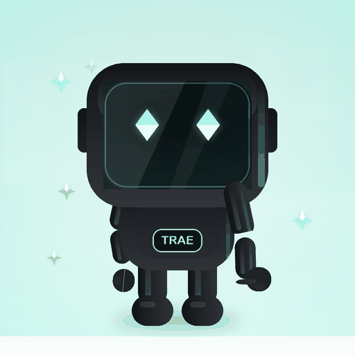

# TRAE宝表情包

围绕 TRAE宝日常聊天场景制作的表情包项目，保存不同版本的静态原画、GIF、全彩动态 WebP 与制作记录。

## 版本与进度

| 目录 | 内容 | 状态 |
| --- | --- | --- |
| `官方素材/` | 活动提供的角色与表情包参考 | 来源参考 |
| `TRAE宝表情包-GIF/` | 第一版六张表情、静态预览及历史制作脚本 | 已有成果 |
| `TRAE宝表情包V3/` | 六张迭代 GIF | 已有成果 |
| `TRAE宝表情包v5/` | 六张 512×512 原画、GIF、WebP 与画质对比 | 已有成果 |
| `TRAE重制版/` | DeepSeek-V4.1-Flash：六张原画基础上的局部动作重制 | 已交付并归档 |
| `Seed自由创作版/` | Seed-2.1-Pro-0915：收到敬礼样稿，分层绘制 | 已交付一张，独立工作树成果快照 |

## 最新两版对照（2026-10-28）

| 原画质重制版 · DeepSeek | 自由创作样稿 · Seed |
| --- | --- |
|  |  |
| 六张，沿用 v5 原画；以局部形变、眼睛及特效动画为主 | 一张，重新分层绘制；关节敬礼、对勾和气泡时间轴 |
| [说明与全部成品](TRAE重制版/README.md) · [下载后本地打开预览](TRAE重制版/预览.html) | [制作记录](Seed自由创作版/01_收到/过程记录/制作记录.md) · [下载后本地打开预览](Seed自由创作版/预览.html) |

已独立逐帧解码核对七张 GIF：全部 512×512、无限循环，GIF 与 WebP 帧数一致。重制版 20–32 帧，0.80–1.92 秒；Seed 样稿 48 帧、1.92 秒。动画自然度与审美仍应通过实际播放比较；完整核对及归档来源见 [两版交付核对](项目管理/两版交付核对.md)。GitHub 文件页不直接运行 HTML，下载后本地打开即可。

## 查看效果

v5 包含“收到、思考、震惊、累瘫、冲刺、辛苦啦”六个情绪。直接打开对应 GIF 或 WebP 即可查看；WebP 可保留更丰富的渐变和颜色。详细规格与动画限制见 [v5 说明](TRAE宝表情包v5/README.md)。

## 来源与制作归属

- 官方参考素材来自 [TRAE宝表情包小赛活动](https://forum.trae.cn/t/topic/462975)，角色/IP 及官方参考图权利归相应权利人所有。
- 既有版本由用户在 ChatGPT 辅助下制作，包含 AI 生成图像和本地动画合成；不能把这些历史成果描述为 TRAE 生成。
- TRAE 重制版已完成六张局部动作动画；Seed 自由创作版已完成一张“收到”样稿。两者均附实际脚本、记录及预览；交付不等同于活动方认定参赛资格。
- 活动要求使用 TRAE 完成主要创作，并在“案例与作品”板块独立投稿、添加活动标签。此前活动帖下的成果分享回复不等同于正式投稿。
- 本仓库未统一授予素材开源许可；如需转载或商用，请分别确认角色、参考素材和生成素材的使用条件。

## 复现说明

第一版 `create_gifs.py` 为历史环境脚本，含原环境的输入、输出及字体路径，并依赖 Pillow、NumPy；直接在新环境运行前需调整路径。后续重制脚本的可复现方法以对应版本完成后的说明为准。

## 协作

主仓库用于归档完成且核查过的版本；并行任务按各自目录写入。不要在未检查的情况下把正在生成的中间文件或其他工作树加入提交。TRAE 操作入口与分工见 [协作说明](项目管理/协作说明.md)。
